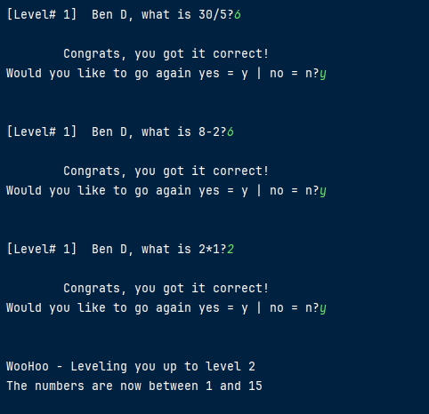
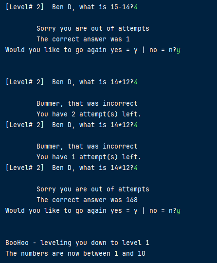
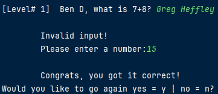
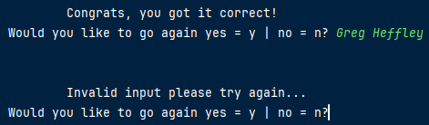
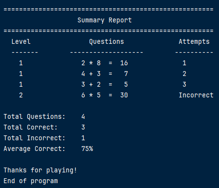

# Math Tutor V4

<b>Table of Content</b>
- [Summary](#summary)
- [Maintainers](#maintainers)
- [New Concepts Used](#new-concepts-used)
- [Console Output Example](#console-output-example)
  - [Leveling up](#leveling-up)
  - [Leveling down](#leveling-down)
  - [Invalid Number input](#invalid-number-input)
  - [Invalid Yes or No Input](#invalid-yes-or-no-input)
  - [Summary report example](#summary-report-example)

## Summary
This is a Silly Simple Math Tutor for young children.
- Display the program header
- Tells a few jokes
- Gets the user's name and welcomes to the user to the game
- Displays a math question of +, -,*, or /
- Gets the user's answer
- Tells the user if they are correct
- Tells the user if they are incorrect 
- Asks the user if they want another question
- Keeps track of the users questions they got right
- Levels them up if they got three questions right
- Levels them down if they got three questions wrong
- If user enters an answer besides a number it will ask them to put in a number
- Says goodbye to the user
- Creates a summary report of each question answered
  - Gives total number of questions answered, correct, incorrect, and the average correct

## Maintainers
[@bendickinson15](https://github.com/Derek0010) Benjamin Dickinson    
[@capacha1](https://github.com/capacha1) Cameron Pacha

## New Concepts Used
- Vectors
- New includes: iomanip and vectors
- 2D vectors
- Set width formatting

## Leveling up

## Leveling down

## Invalid number input

## Invalid Yes or No input

## Summary report example

[Back to Top](#math-tutor-v3)
